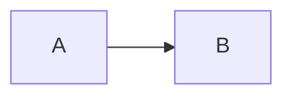
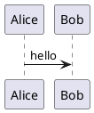

# Authoring guide

Course content is plain Markdown, so it also reads well on GitHub. This
guide describes the repository layout and the Markdown features you can use.

## Repository layout

```
README.md                         home page of the website
info/
  general.yaml                    course information  (see course-info.md)
  assessment.yaml                 assessment components and their matrices
  genAI.yaml                      generative-AI policy for the assignments
  *.md                            extra pages under "Course information"
lessons/
  week_01/
    README.md                     week overview (title = week name)
    lecture1.md                   lectures, in file-name order
    lecture2.md
    images/                       images, data, ... (any name)
assignments/
  week_01/
    README.md                     optional: introduction to the week's assignments
    assignment1.md                a single-page assignment
    es_w1_session1.md             a logbook, named in an assignment's front matter
    assignment2/                  an assignment with files
      index.md                    the assignment (README.md also works)
      starter/                    zipped as week_01-assignment2.zip and linked
slides/
  week_01/
    lecture1.pptx                 the PowerPoint source (not published)
    lecture1.pdf                  exported PDF, shown on lessons/week_01/lecture1.md
exams/
  README.md                       optional introduction
  example_exam.md
references/
  README.md                       optional introduction
  *.md, *.pdf
```

- **Weeks** are directories named `week_01`, `week_02`, … `week_10`, … (an
  underscore and at least two digits, so they sort correctly) in `lessons/`,
  `assignments/` and `slides/`. A week appears in the sidebar as soon as one
  of them exists. Add or remove weeks freely. Directories with other names,
  such as `week1`, are ignored, with a warning.
- **Week names** come from the title of `lessons/week_NN/README.md`: the title
  "Stacks and queues" in `lessons/week_02/README.md` gives
  "Week 2: Stacks and queues" in the sidebar.
- **Order:** pages are ordered by file name (`lecture2` before `lecture10`).
  To override this, add `order: 1` (2, 3, …) to the front matter.
- **`private` directories** are never published, wherever they are: solutions,
  exam answers, hidden tests. They are also left out of starter-file zips.
  They are still in the git repository, so keep the repository private if
  that matters.
- Files and directories whose names start with `.` are ignored.

## Page titles

The title of a page is, in order of preference:

1. `title:` in YAML front matter;
2. the first line of the file, if it is a level-1 heading (`# Title`);
3. the file name (`lecture1.md` → "Lecture 1").

Option 2 is recommended: it reads well on GitHub. Start sections with `##`.

## Learning outcomes of a page

Name the learning outcomes that a page works towards in its front matter,
with the ids from `info/general.yaml`:

```yaml
---
outcomes: [LO1, LO3]
---
```

The page then shows these outcomes at the top, under the title: by their
`title` (see [course-info.md](course-info.md#learning-outcomes)), or by their
id if they have none. Pointing at an outcome shows the whole outcome; clicking
it opens the outcome map. Next to them is an estimate of the reading time
(about 200 words and 20 lines of code a minute). In the PDF, the outcomes are
one line under the title.

As soon as one page names outcomes, the course gets an **outcome map**
(*Course information* in the sidebar). It shows, for every learning outcome,
the weeks and pages that work towards it and the assessment components that
assess it (from the matrices in `info/assessment.yaml`). The build warns
about an outcome that no page covers, and about ids that are not in
`general.yaml`. Any page can name outcomes: lessons, assignments, exams,
week overviews.

## Slides

Export the PowerPoint slides to PDF (*File → Export → PDF*) and commit the PDF
next to the `.pptx` in `slides/week_NN/`, with the same name as the lecture. The
lecture page `lessons/week_NN/lecture1.md` then shows a "Slides" box linking to
`slides/week_NN/lecture1.pdf`. Without a PDF, the box says "No presentation
yet". The `.pptx` files are not published.

In the front matter of a lecture:

```yaml
slides: intro-and-overview   # use slides/week_NN/intro-and-overview.pdf instead
slides: false                # no slides box on this page
```

## Assignments with starter files

Put the assignment in its own directory with an `index.md` and a `starter/`
directory. The starter directory is zipped (as `week_NN-<name>.zip`) and a
download box is added to the top of the assignment. Anything in a `private`
directory, like a reference solution, stays out of the zip and the website.

## Generative AI in assignments

The course's GenAI policy is set in `info/genAI.yaml` (see
[course-info.md](course-info.md#infogenaiyaml)). Every assignment page shows
at the top what is allowed in it: GenAI *allowed, with citation*, *as a tutor
only* (to explain things; nothing generated is handed in) or *not allowed*.
Where the policy permits, an assignment deviates from the course default in
its front matter:

```yaml
---
genai: allowed               # or: tutor, not-allowed
---
```

Add a `note` to explain the exception:

```yaml
---
genai:
  use: allowed
  note: Use it for the tests only; write `is_balanced` yourself.
---
```

## Logbooks

A logbook is a Markdown file that students download, fill in (code,
answers, names) and hand in, for example as a PDF. Name it in the front
matter of its assignment, with a path relative to the assignment:

```yaml
---
logbook: es_w1_session1.md         # several: [session1.md, session2.md]
---
```

The assignment page then gets a *Logbook* box with a link to **download** the
file, published unchanged, and a link to a **preview** on the website. The
preview page links back to the assignment and has no PDF. A file named as a
logbook is not an assignment of its own, so it does not appear in the
sidebar.

## Links

Link to other pages by their Markdown file, with a relative path, as on
GitHub:

```markdown
See [lecture 2](lecture2.md) and the [first assignment](../../assignments/week_01/assignment1.md).
The [course information](info/general.yaml), [assessment](info/assessment.yaml)
and [GenAI policy](info/genAI.yaml).
```

On the website these become links to the pages. In PDFs they become links to
the published website.

Links to PDF files (slides, references, the PDF version of a page, or any PDF
you link to) open in a new tab, in the browser's PDF viewer, also when the page
is embedded in Brightspace. Links to `info/general.yaml`, `info/assessment.yaml`
and `info/genAI.yaml` lead to the generated pages.

## Markdown features

The Markdown is [Pandoc Markdown](https://quarto.org/docs/authoring/markdown-basics.html)
as used by Quarto: everything from GitHub Markdown, plus the features below.
See `lessons/week_01/lecture1.md` in the template course for examples of all of
them.

### Math

```markdown
Inline $O(n \log n)$ and display math:

$$
\sum_{i=1}^{n} i = \frac{n(n+1)}{2}
$$
```

### Callouts

```markdown
::: {.callout-tip}
## Optional title
Text of the tip.
:::
```

The types are `callout-note`, `callout-tip`, `callout-warning`,
`callout-important` and `callout-caution`.

### Tabs

```markdown
::: {.panel-tabset}
### Python
...
### C
...
:::
```

In the PDF, tabs are shown one after the other.

### Code

Fenced code blocks with a language get syntax highlighting and, on the
website, a copy button. Code is only displayed, never run: even
```` ```{python} ```` is shown as a normal code block.

### Code annotations

Explain lines of code with a numbered comment marker at the end of the line
and a numbered list *directly* after the code block
([Quarto code annotations](https://quarto.org/docs/authoring/code-annotation.html)):

````markdown
```c
int best = values[0];                  // <1>
for (size_t i = 1; i < n; i++) {       // <2>
```
1. Start with the first value as the best so far.
2. Compare every other value with it.
````

Use the comment syntax of the language: `// <1>` in C, C++, Java, JavaScript,
`# <1>` in Python, Bash, YAML, and so on. (Quarto itself only accepts
`/* <1> */` in C; course-tools converts `// <1>` for you.) On the website the
markers become numbers right after the code, aligned in one column; in the PDF
they become circled numbers (`// ①`). Both match the list below the code.

### Diagrams

Mermaid and PlantUML are written in fenced blocks. GitHub shows Mermaid
diagrams in its preview too:

````markdown



````

Diagrams are **centred** on the website and in the PDF. To align one on the
left (or right) instead, start it with a `fig-align` comment line. The comment
marker is `%%` in Mermaid and `'` in PlantUML, so GitHub and the diagram tools
ignore the line:

````markdown


````

### Images

```markdown
{width=60%}
```

Use paths relative to the page. SVG gives the sharpest result on screen and in
PDFs.

## Self-checks

A self-check is a short question in a lesson that students answer on the
page, as often as they like. Nothing is graded or stored: the checks are for
practice. Use Brightspace quizzes for graded tests.

On the website, students click *Check*. After a wrong attempt, *Show answer*
appears. In the PDF, the question is printed without the answer; the answers,
feedback and explanations are in an *Answers* section at the end of the
page.

### Multiple choice

Write the options as a task list and mark the right ones with `[x]`. Feedback
for an option goes in an indented paragraph under it; students see it after
choosing that option.

```markdown
::: {.check}
Which statements about `volatile` are true?

- [x] Every read of the variable really reads memory.

  Right: the compiler may not keep the value in a register.

- [ ] Accesses to the variable become atomic.

  No. On an 8-bit AVR, reading a 16-bit variable takes two instructions,
  and an interrupt can come in between.

::: {.explanation}
`volatile` is about what the compiler does; atomicity is about the hardware.
:::
:::
```

- One right option gives radio buttons (choose one); more right options give
  checkboxes and the text "Select all that apply". To get checkboxes with one
  right option, so that the question does not give that away, write
  `::: {.check type="multiple"}`.
- The optional `::: {.explanation}` is shown when the answer is right, or
  after *Show answer*. It works for fill-in questions too.

### Fill in the blanks

Put the answer in square brackets with `{.blank}` after it. A check can have
several blanks.

```markdown
::: {.check}
`0x2A` is [42]{.blank} in decimal and [101010]{.blank type=bin} in binary.
:::

::: {.check}
A 10 kHz PWM signal has a period of [0.1]{.blank type=float precision=0.001 unit=ms}.
:::

::: {.check}
The keyword is [`volatile`]{.blank case=sensitive}; an interrupt handler is
also called an [ISR]{.blank accept="interrupt service routine|interrupt handler"}.
:::
```

`type` sets what the student must enter:

| `type` | Answer | Accepted input |
|:--|:--|:--|
| `int` | a whole number | `42`, `-7`, `1 000` |
| `hex` | a hexadecimal number | `2A`, `0x2a`, `2Ah` |
| `bin` | a binary number | `101010`, `0b10_1010` |
| `float` | a number | `0.1`, `0,1`, `1e-1` |
| `text` | text | see `case`, `spaces` and `accept` |

Without `type`, the type follows from the answer: `42` is `int`, `0x2A`
`hex`, `0b1010` `bin`, `3.3` `float`, anything else `text`. Set the type for
a hexadecimal answer without `0x`, and for a decimal number with a tolerance.
Numbers are compared by value, so `0X2A` is right for `0x2A`. A student who
types a hexadecimal number into an `int` blank is told what to enter.

More options for a blank:

- `precision` (`float`): the tolerance, as an amount (`precision=0.001`) or a
  percentage of the answer (`precision=1%`). Without it, the number must be
  exact.
- `case` (`text`): `ignore` (default) or `sensitive`.
- `spaces` (`text`): `normalize` (default: extra spaces don't matter) or
  `ignore` (no spaces matter, useful for code such as `PORTB |= (1 << 5);`).
- `accept` (`text`): other right answers, separated by `|`.
- `unit`: shown after the blank, for example `unit=ms`.
- `width`: the width of the blank in characters.

An answer written as code (`` [`volatile`]{.blank} ``) gets a blank in a code
font.

## Predict

Students predict what code does before they see the answer: the *Reveal*
button only works after they wrote a prediction. Afterwards they mark whether
their prediction was right.

````markdown
::: {.predict}
What does this program print?

```{c ce=run}
#include <stdio.h>
#include <stdint.h>

int main(void) {
    uint8_t x = 200;
    x += 100;
    printf("%u\n", x);
}
```

::: {.answer}
`44`: a `uint8_t` wraps around at 256.
:::
:::
````

Compiler Explorer links (see below) inside a prediction appear only after the
answer is revealed, so that students can run the code to check their
prediction, but not before they made one. In the PDF, the answer is in the
*Answers* section.

## Compare

Two code blocks side by side, each with a label. The lines that differ are
marked. Add `.wrong-right` to show the first label in red and the second in
green.

````markdown
::: {.compare .wrong-right labels="Without volatile|With volatile"}
```c
uint8_t tick;
```

```c
volatile uint8_t tick;
```
:::
````

Text before the first code block appears above the comparison. On a phone,
and in the PDF, the blocks are shown one below the other.

## Compiler Explorer

A link under a code block opens the code in
[Compiler Explorer](https://godbolt.org), compiled with the course's compiler.
Add `ce` to the code block:

````markdown
```{c ce=asm}
int square(int x) {
    return x * x;
}
```
````

| `ce` | Compiler Explorer shows |
|:--|:--|
| `asm` | the assembly |
| `run` | the assembly and the output of the program (`asm run` means the same) |
| `exe` | only the output of the program |

The compiler, its options and the target (a label shown next to the link) are
set for the course in `info/general.yaml` (see
[course-info.md](course-info.md#compiler-explorer)). A page can change them
in its front matter, with the same keys:

```yaml
---
compiler_explorer:
  target: x86-64
  compiler: cg152
  options: -O0
---
```

A code block can change them with attributes:

````markdown
```{c ce=asm ce-compiler=cavrg1520 ce-options="-Os -mmcu=atmega328p" ce-target="ATmega328P"}
````

For `ce=exe`, `ce-stdin` gives the program input (`\n` for a new line) and
`ce-args` its arguments: `` ```{c ce=exe ce-stdin="3\n4"} ``.

Notes:

- Compiler Explorer can only **run** programs for x86-64 (a PC), not for
  ARM, AVR or RISC-V. For `run` and `exe`, the `run` settings are used (see
  course-info.md), so the assembly can be for the microcontroller while the
  program runs on a PC.
- The code of the block is the whole program Compiler Explorer gets, so add
  the `#include`s it needs. Code annotation markers (`// <1>`) are left out.
- The link contains the code itself: it needs no account and does not expire.
  Opening it sends the code to godbolt.org.
- Compiler ids: open the compiler list in Compiler Explorer, or see
  <https://godbolt.org/api/compilers/c> (C) and
  <https://godbolt.org/api/compilers/c++> (C++).

## Key terms

List the key terms of a page in a `::: {.terms}` block, as a definition list:
the term on one line, the definition on the next, starting with `: `.

```markdown
::: {.terms}
superloop
: An endless loop in `main` that reads inputs and updates outputs, over and
  over.

`volatile`
: A qualifier that tells the compiler that a variable can change outside the
  normal program flow.

[ISR]{aliases="interrupt service routine|interrupt handler"}
: A function that the hardware calls when an interrupt occurs.

    A second paragraph is indented by four spaces.
:::
```

From these blocks, the website gets:

- **A *Key terms* box** on the page itself, where you put the block (usually
  near the top).
- **Definitions on first use**, on every page: the first time a key term is
  used on a page, it is underlined; pointing at it (or tapping it) shows its
  definition, with links to the page that introduces it and to the glossary.
  Plurals (*ISRs*) and the other names in `aliases` count too, and so does
  inline code that is exactly the term (`` `volatile` ``). Headings, links,
  code blocks, self-checks and predictions are skipped: there, a definition
  could give the answer away.
- **The glossary** (*Key terms* in the sidebar): all terms from A to Z, each
  linking to where it is introduced. It is also a PDF.
- **Review key terms**: flash cards with spaced repetition. A card that a
  student knows comes back after 1, 3, 7, 16 and 35 days; one they don't
  know comes back the same day. Students choose the weeks to review (terms
  from pages outside the weeks are under *Other*) and whether they are asked
  for the definition or the term. Progress is saved in their browser only.

Notes:

- Define each term once, where it is introduced. If a term is defined twice,
  the build warns and the glossary uses the first definition (in course
  order: course information, weeks, exams, references).
- Links in a definition can be relative to the page, as everywhere: they
  work in the glossary too.
- Without key terms, the course has no glossary and no review page.
- In the PDF of a page, the key terms are a box; there are no tooltips.

## Page footer: dates from git

Every page ends with a footer that says when its source file was added to the
repository and when, and by whom, it was last changed:

> Added on 23 February 2026.
> Last changed on 5 September 2026 at 14:32 by Robert Changeling.

The dates and the name come from the git history of the page's source file
(for the course information pages: the YAML file). Times are shown in Dutch
time. Renamed or moved files keep their original date. The name is the
author name of the commit, so set it properly once:
`git config --global user.name "Your Name"`. Files that are not committed yet
have no footer.

## Previewing

Run `course preview` in the course repository. It shows the website on
<http://localhost:4200> and updates the page when you save a file. Run
`course build` for the full output, including the PDFs, in `dist/`. Add
`?embed=1` to a page URL to see it as it appears in Brightspace.
