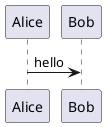
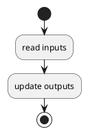
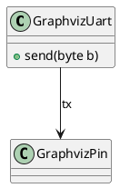

# Superloops

A lesson that uses the Markdown features. Inline math $O(n)$, a link to
[lesson 2](lesson2.md), the [assessment](../../info/assessment.yaml), the
[week overview](README.md) and the [slides](../../slides/week_01/lesson1.pdf).

$$
T(n) = \sum_{i=1}^{n} c = c \cdot n
$$

::: {.terms}
superloop
: An endless loop in `main` that reads inputs and updates outputs, over and
over.

[ISR]{aliases="interrupt service routine|interrupt handler"}
: A function that the hardware calls when an interrupt occurs.

    It runs in between two instructions of the main program; see
    [lesson 2](lesson2.md).
:::

A superloop is the simplest structure for embedded software.

::: {.callout-tip}
## Remember
CALLOUT-TIP-TEXT
:::

::: {.panel-tabset}
### C
```c
printf("hello\n");
```
### Python
```python
print("hello")
```
:::

## Annotated code

```c
int main(void) {
    setup();                 // <1>
    while (1) {              // <2>
        loop();
    }
}
```
1. Configure the hardware once.
2. Repeat forever.

Executable-cell syntax is shown, never run:

```{python}
print("SHOWN-NEVER-RUN")
```

## Diagrams








{width=40%}

---
Text right after a horizontal rule, and a list right after text:
- first item
- second item
